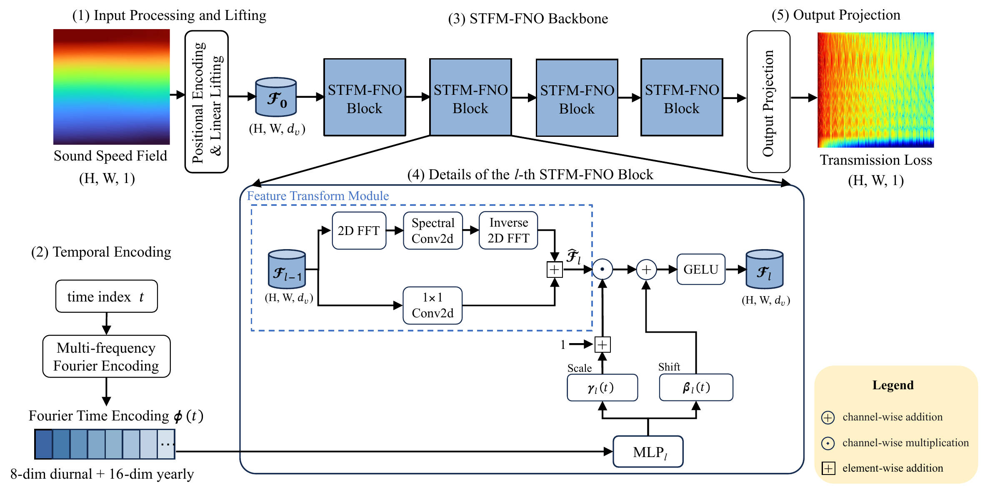
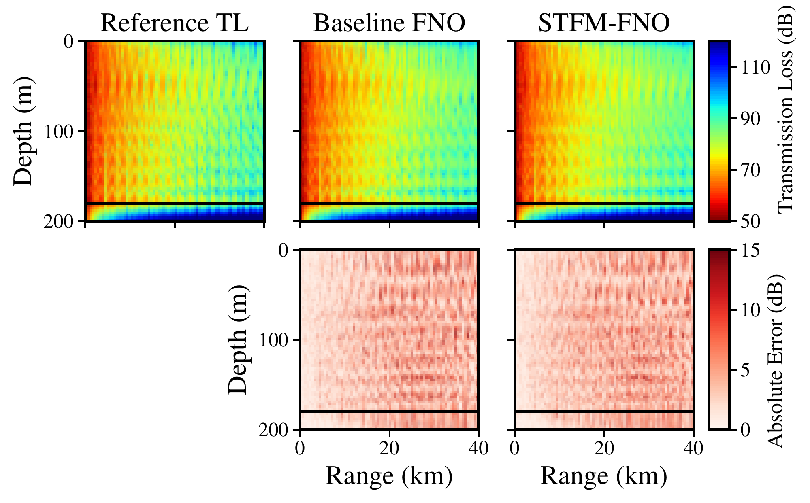
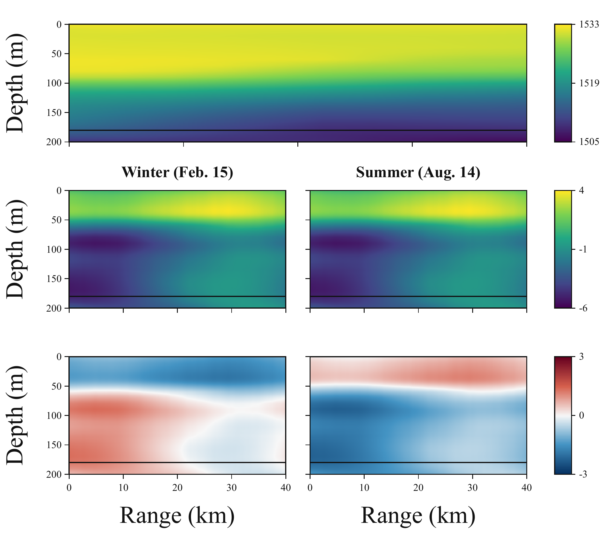

# STFM-FNO: Transmission Loss Estimation

Research code for **Spatio-Temporal Field-Modulated Fourier Neural Operator for Transmission Loss Estimation**, by **Yufei Yang, Yifan Sun, Lei Cheng, and Peter Gerstoft**.

The manuscript was accepted by *IEEE Signal Processing Letters* on September 27, 2026, according to the authors' final-submission record. [Project page](https://yufeila.github.io/STFM-FNO/) · [Accepted manuscript](docs/paper.pdf) · [Reproduction protocol](docs/REPRODUCIBILITY.md) · [Data specification](docs/DATA.md) · [Citation](CITATION.cff)

STFM-FNO estimates underwater acoustic transmission-loss (TL) fields from a sound-speed field (SSF) and its acquisition time. A 24-dimensional daily/yearly Fourier encoding generates channel-wise affine modulation inside four FNO blocks. Time supplies an auxiliary inductive bias for learning from temporally organized data; the SSF remains the physical environmental input.

Originally developed as TAM-FNO, this repository now uses the final paper name STFM-FNO. Version 0.2.0 replaces the earlier random-split entry points with the final monthly blocked protocol.

## Method overview



**Figure 1 — STFM-FNO architecture.** The sound-speed field and spatial coordinates enter the spatial branch. Fourier-encoded time generates block-wise affine parameters, with one scale and shift per channel broadcast over the spatial grid. Their interaction with latent spatial features produces the modulation field. [Original figure PDF](docs/figures/figure_1_architecture.pdf).

The design retains a shared spectral backbone while introducing temporal conditioning within its feature representation. The temporal branch uses four daily and eight yearly sine-cosine harmonics; each block has its own modulation generator.

## Release scope

This release contains the proposed model, all six Table I models, all three Table II encodings, a frozen chronological split, portable training/evaluation commands, and recorded reference metrics. It does **not** include the research dataset, trained checkpoints, or a RAM solver. Full numerical reproduction requires the paired SSP/TL files described below. There is no verified public download for the study-specific paired SSP/TL files or checkpoints in the supplied project records.

The release preserves the model arithmetic used in the experiments while consolidating the research scripts. Recorded results come from the original experiments; the portable release has not been retrained for all paper experiments. Hardware, numerical kernels, and refactoring can affect rerun values. The 100-Hz experiment and publication figure-authoring workflows are outside this release's automated reproduction scope; see [the protocol](docs/REPRODUCIBILITY.md).

## Installation and quick check

The existing experiment environment was inspected as Python **3.10.20**, PyTorch **2.5.1** / CUDA **12.1**, NumPy **1.26.4**, SciPy **1.11.4**, h5py **3.11.0**, and scikit-image **0.25.2**, on Linux with NVIDIA A800 GPUs. The pinned dependencies reflect that environment. CPU is supported for the synthetic check; paper-scale training requires substantial RAM and GPU memory.

```bash
git clone https://github.com/yufeila/STFM-FNO.git
cd STFM-FNO
conda env create -f environment.yml
conda activate stfm_fno
pip install -e .
python -m stfm_fno.experiments smoke --device cpu
```

For a CUDA 12.1 environment, install the matching PyTorch wheel before the editable package:

```bash
pip install torch==2.5.1+cu121 --index-url https://download.pytorch.org/whl/cu121
pip install -e .
```

Specifying `+cu121` also replaces a previously installed CUDA build with a different local version. The wheel command follows the [official PyTorch previous-version instructions](https://pytorch.org/get-started/previous-versions/). With a Python 3.10 environment, pip-only installation is also available through `pip install -r requirements.txt` followed by `pip install -e .`.

The synthetic check uses small models and generated fields to check forward/backward computation and checkpoint reloads. It does not validate paper accuracy. Training and evaluation default to CUDA; pass `--device cpu` for CPU execution. Unavailable CUDA raises an error instead of silently changing the experiment. Use `python -m stfm_fno.experiments --help` for the available commands.

## Data and split

Provide paired files outside version control:

```text
raw_data/
├── SSP.mat   # square_SSP: (2920, 21, 10) after MATLAB axis conversion
└── TL.mat    # square_TL:  (2920, 199, 800) after MATLAB axis conversion
```

Samples must retain the original chronological order: **365 days × 8 samples/day**, with 0-based global indices `0...2919`. SSP values are sound speed in m/s; TL values are dB. MATLAB v7.3 HDF5 axes are reversed on load, and SSP is resized to `199 × 800` using bilinear interpolation with `align_corners=True`. Shape checks cannot establish chronology, pairing, or the acoustic configuration; verify those properties before training.

The main dataset uses 200-Hz RAM-generated TL labels with source depth 50 m. The paper cites S. Li et al., “Learning data distribution of three-dimensional ocean sound speed fields via diffusion models,” *JASA*, 155(5), 3410–3425, 2024. This source citation is not a dataset distribution license. Dataset access and redistribution permissions must be obtained from the relevant rights holders; the code license does not grant rights to the dataset.

The frozen `monthly_stratified_blocked_gap1d` protocol has **2144 training, 584 test, and 192 purged samples**. Each month contributes a central continuous test block: February has 7 days, and the other months have 6. One day on either side is purged. [configs/monthly_split.json](configs/monthly_split.json) contains every index; generated indices are verified against the historical manifest. Both input and target normalization statistics are fitted only on training samples.

```bash
python scripts/validate_data.py --raw-ssp raw_data/SSP.mat --raw-tl raw_data/TL.mat
```

The default check inspects file keys and shapes without loading the full TL array. Add `--full` to check finite values and record SHA-256 file hashes. This still cannot prove sample chronology.

## Reproducing the tables

The paper settings are recorded in [configs/paper.json](configs/paper.json): four Fourier blocks, modes `(32, 128)`, width `64`, batch size `20`, Adam with learning rate `1e-3` and weight decay `1e-4`, StepLR with step size `50` and factor `0.5`, and `H1Loss(beta=0.01)` for **100 epochs**. Evaluation uses the final epoch, with no selection of a checkpoint by test performance. The test set is evaluated in physical dB units using its actual frozen global indices.

Table I uses **seed 1**. The following commands train and evaluate all six models sequentially:

```bash
bash scripts/reproduce_table1.sh raw_data/SSP.mat raw_data/TL.mat outputs/table1 cuda:0
```

Table II uses **seeds 1, 2, 3** and three temporal encodings:

```bash
bash scripts/reproduce_table2.sh raw_data/SSP.mat raw_data/TL.mat outputs/table2 cuda:0
```

For a single proposed-model run:

```bash
python -m stfm_fno.experiments train \
  --variant film --seed 1 --epochs 100 --device cuda:0 \
  --raw-ssp raw_data/SSP.mat --raw-tl raw_data/TL.mat \
  --manifest configs/monthly_split.json --output-dir outputs/table1
python -m stfm_fno.experiments evaluate \
  --variant film --seed 1 --device cuda:0 \
  --raw-ssp raw_data/SSP.mat --raw-tl raw_data/TL.mat \
  --manifest configs/monthly_split.json --output-dir outputs/table1
```

Training outputs include model configuration, software/environment information, data/split hashes, train-only normalizers, loss history, and the final checkpoint. Evaluation produces overall and per-sample metrics. Existing completed runs are protected against accidental overwrite. See [the protocol](docs/REPRODUCIBILITY.md) for the artifact layout, aggregation, and implementation details.

## Paper results

The tables below transcribe the accepted manuscript's displayed values. They are **recorded results**, not measurements produced by this release's synthetic check. Full-precision historical values are retained in [reference_results/table1.json](reference_results/table1.json) and [reference_results/table2.json](reference_results/table2.json).

### TL predictions and errors



**Figure 2 — Qualitative comparison from the accepted manuscript.** TL estimates and absolute errors for a monthly test sample (`global_idx = 1830`, August 17). The black line marks the bottom at a depth of 180 m. This figure illustrates one held-out case; the table below reports averages over the complete test set. [Original figure PDF](docs/figures/figure_2_tl_predictions.pdf).

**Table I — fixed epoch 100, seed 1.** Each metric is computed per test field and then averaged over all 584 fields. Lower is better for RMSE and relative L2; higher is better for SSIM and PCC.

| Model | CLI variant | RMSE (dB) ↓ | Rel. L2 ↓ | SSIM ↑ | PCC ↑ |
|---|---|---:|---:|---:|---:|
| Baseline FNO | `baseline` | 4.15 | 0.052 | 0.787 | 0.952 |
| Concat (Scalar) | `scalar` | 4.22 | 0.053 | 0.781 | 0.951 |
| Concat (PE) | `pe` | 4.77 | 0.059 | 0.734 | 0.938 |
| FNM-FNO | `fnm` | 4.42 | 0.055 | 0.755 | 0.947 |
| Low-rank Hyper-FNO | `hyper` | 4.14 | 0.052 | 0.787 | 0.952 |
| **STFM-FNO** | `film` | **3.95** | **0.049** | **0.800** | **0.956** |

The manuscript reports FNM-FNO PCC as `0.947`; its saved full-precision value is `0.946498973425821`. The paper transcription and exact reference JSON retain that discrepancy transparently.

**Table II — mean RMSE across seeds 1, 2, 3.** The encodings perform comparably at the reported precision. Standard deviations below are the historical sample standard deviations across the three runs, not confidence intervals.

| Temporal encoding | CLI variant | Paper RMSE (dB) | Exact mean ± sample std (dB) |
|---|---|---:|---:|
| Generic-Fourier-FiLM | `generic_fourier_film` | 3.96 | 3.96137 ± 0.02203 |
| Learned-frequency-FiLM | `time2vec_film` | 3.91 | 3.90723 ± 0.03820 |
| Ours (daily + yearly) | `ours_fourier_film` | 3.90 | 3.89666 ± 0.05814 |

`time2vec_film` is the experiment identifier for the paper's Learned-frequency-FiLM control, implemented here as one learned linear channel and 23 learned sine channels with bounded frequencies. It is not a claim that this repository contains the cited external paper's full implementation.

### Inspecting temporal modulation



**Figure 3 — Feature interception in the first STFM-FNO block.** The top row shows the shared input sound-speed field; the next two rows show representative unmodulated features and latent modulation fields. The columns compare winter (`t = 360`, February 15) and summer (`t = 1800`, August 14) conditioning for the same held-out input. Changing only the time index isolates the temporal branch's effect on latent modulation. [Original figure PDF](docs/figures/figure_3_feature_modulation.pdf).

All three figures above are taken from the accepted manuscript. The PNG files are display exports of the original PDFs; the plots and their labels have not been redrawn.

## Repository layout

```text
src/stfm_fno/          Models, encodings, data, split, normalization, experiment CLI
scripts/              Table reproduction helpers and data checks
configs/              Paper settings and frozen chronological indices
reference_results/    Full-precision recorded experiment summaries
docs/                 Accepted manuscript, original figures, and reproduction documentation
LICENSES/             Third-party license texts
CITATION.cff          Machine-readable software and paper citation
THIRD_PARTY_NOTICES.md Source attribution and dependency notices
```

## Acknowledgments

This work was supported by the Zhejiang Provincial Natural Science Foundation of China (LR26F010004), the National Natural Science Foundation of China (62622127, 62371418), the Fundamental Research Funds for the Central Universities (226-2025-00168), and the Novo Nordisk Foundation (NNF24OC0089302).

## Citation and license

Please cite the paper when using the model or experiments. DOI, volume, and pages are omitted because they are not available in the supplied final-submission record. Update this entry when verified publication metadata become available.

```bibtex
@article{yang2026stfmfno,
  title   = {Spatio-Temporal Field-Modulated Fourier Neural Operator for Transmission Loss Estimation},
  author  = {Yang, Yufei and Sun, Yifan and Cheng, Lei and Gerstoft, Peter},
  journal = {IEEE Signal Processing Letters},
  year    = {2026},
  note    = {Accepted manuscript}
}
```

The software is distributed under the [MIT License](LICENSE). Third-party source ancestry and license notices are documented in [THIRD_PARTY_NOTICES.md](THIRD_PARTY_NOTICES.md). The software license applies to code; the manuscript and external research data retain their respective rights.

For questions or reproducible bug reports, use the [repository issue tracker](https://github.com/yufeila/STFM-FNO/issues). Please include your command, environment, and configuration, without attaching private data.
